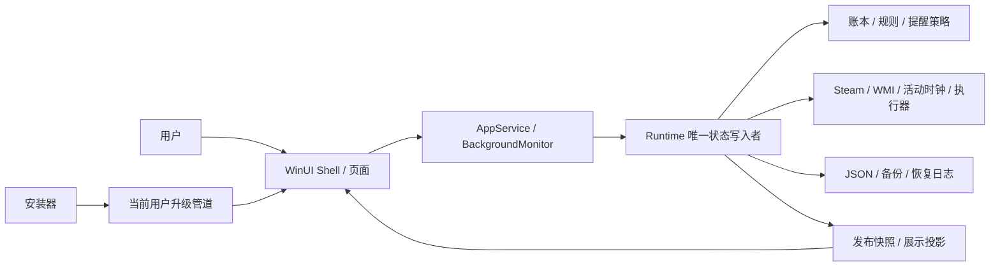

# SteamWatch 当前架构

描述当前源码的组件、状态和数据流，不代表重构全部完成。目标选择见 [重设计](redesign-v2.md)，行为见 [SPEC](../SPEC.md)，实际进度见 本地 `STATUS.md`。

## 系统边界与组件

用户经页面提交命令；Runtime 通过串行门操作领域状态和适配器，持久化成功后发布结果。安装器只能请求正常退出，认证在 UI 内完成，不接触密码。Steam 数据、进程和 Windows 通知来自本机，不引入云服务。

| 组件 | 职责与状态所有权 |
| --- | --- |
| Core | PlaytimeLedger 是精确计量事实源；规则自然身份、日周评估、提醒/强退策略。旧 RunningGameSession 仅兼容，非当前计量入口 |
| Infrastructure/Runtime | SteamWatchRuntimeService 唯一写入者；初始化、目录/采样、规则/设置/分类、修正/恢复和 Flush 串行；接口注入目录/进程/时钟/执行/通知 |
| SteamWatchAppService | 适配 WinUI、后台监控和 DTO→展示；不把页面展示计时器当运行采样器 |
| MainPage / MainWindow | Shell 导航、共享认证/对话框/命令门、窗口托盘与退出；维护和估算仍有 Shell partial 编排 |
| GamePage / ViewModels | 预算、游戏行、筛选/选择、固定目标规则编辑；页面不创建后台循环 |
| StatisticsPage / ViewModel | 独立日/周日期、周期、摘要/七日趋势；估算修正请求交 Shell |
| SettingsPage / ViewModel | 控件同步、分区草稿/校验/保存状态；密码仅在 PasswordBox 和局部调用，不作为普通 ViewModel 字段 |
| HelpPage | 指南、关于、相关设置导航；不直接修改设置 |

源码入口：[App](../src/SteamWatch.App/App.xaml.cs)、[运行服务](../src/SteamWatch.Infrastructure/Runtime/SteamWatchRuntimeService.cs)、[AppService](../src/SteamWatch.App/Services/SteamWatchAppService.cs)。当前是独立页面与可测试状态的渐进结构，不宣称完整 MVVM 重写。

## 采样、计量与执行数据流

后台按 10 秒周期 Poll，WMI/安装根目录和明确 AppID 识别游戏；WindowsRuntimeClock 使用 QueryUnbiasedInterruptTime，活动时间不含休眠、不受校时影响，本地日期决定归属。会话 checkpoint→保存账本→评估规则/提醒/强退→发布快照。保存失败保留 dirty 并禁止后续破坏性执行。

规则协调器按稳定身份维护提醒/倒计时，仅规则内容或日周周期变化重置相关状态；声音/关闭行为不重置，暂停显式清除后恢复新宽限。全局与单游戏规则共用当前实测输入；协调器筛选本周历史供本次评估复用，RecordBook 周查询为七日字典查找，无跨评估缓存。

终止前核对路径与创建时间，温和关闭后等 3 秒，仍存活再核对身份并终止，最多再等 3 秒确认。系统权限/反作弊/保存对话框的实际效果由真实验收确定，不猜测成功。

## 展示快照与共享命令

Runtime.Publish 用 CreateReadSnapshot 生成独立统计/名称/估算副本，不复制持久化 ticks/基线；限额使用不含估算记录。RuntimeReadModel 一次捕获快照/本地日期、构建 MeasuredBook；预算、游戏、统计与七日图复用同代数据，图表不重建完整实测历史。静态 RuntimePresentation 保留兼容投影；持久化仍用 Export，详见 [数据模型](architecture/data-model.md)。

Shell 手动刷新直接应用返回快照，展示计时器只读已发布状态。统计切换用最近展示对象并保留日期；估算弹窗捕获记录和期待值，真正写入再校验。游戏列表按 AppID 复用行，集合更新暂忽略选择事件，过滤/移除目标清空选择；菜单捕获实际行，不跟随之后的选择。

UiOperationCoordinator 拒绝重复命令、不排队重放；规则/分类、估算、备份/恢复/诊断从弹窗、认证、系统选择器到写入完整持有忙碌门，期间禁设置/导航/退出。结束统一应用快照并保留反馈，避免持有门时嵌套刷新。设置仍有独立草稿/保存门，Shell 检查待保存；卸载直接走退出准备，避免被自身命令门阻止。

## 草稿、退出与生命周期

SettingsEdits 只合并当前分区到最新保存值；即时失败仅回填常规，显式失败保留当前草稿。导航保存/放弃/继续编辑共用确认并恢复焦点。完整初始化/恢复才回填全部设置；常规 SelectionChanged 通过 DispatcherQueue 等控件提交后保存，排队也属 HasPendingSave，避免禁表单打断 ComboBox。

ExitPreparation 顺序为草稿决定→最新认证→Shutdown；成功持有退出状态直到提交或恢复。Shutdown 共用 BackgroundMonitor.StopAndFlushAsync：先等待旧循环停止，再 Flush；保存失败恢复监控并向调用者抛错，退出门负责恢复命令/导航。BackgroundMonitor 持有唯一任务/本代取消源；停止期间不重启，完成后可使用新令牌，重复恢复不新增循环。服务级受控探针复用此方法及 ExitPreparation，原生交互仍单独验证。升级通信与恢复异常边界见 [协议](architecture/upgrade-protocol.md)。

MainPage Loaded/Unloaded 成对订阅/退订通知及展示计时器，后台独立。重新附着复用初始化任务；委托捕获 PresentationLifetime 代次，进入 Dispatcher 与取得对话框门后复核，拒绝旧代通知。退出挂起不新开应用内通知。初始化读取失败不启展示计时器，避免空快照抹掉错误；手动刷新可重试。原生重挂载是否完成只见 STATUS。

## 数据、安全与恢复边界

字段、v1/v2、备份日志与原子存储唯一细节源为 [数据模型](architecture/data-model.md)。恢复日志未完成时不启动部分状态监控；单实例按数据目录隔离，外部编辑器/旧版本不受同进程写门约束。认证减少应用内绕过，不能防任务管理器/本地文件改写/系统卸载；无默认免认证期。

DiagnosticLog 记录时间/分类/异常类型；DiagnosticPackage 仅白名单摘要与日志尾部，最多读取 256 KiB、保留 1000 条、包上限 1 MiB，不含凭据/账号/游戏名/路径/异常原文。完整备份与诊断分开。系统通知失败可回退应用内提示，通知不驱动计量。

## 部署、绿色入口与构建

当前 App 使用 .NET 10/WinUI 3/Windows App SDK，构建目标和最低版本以项目文件为准；版本来自 Directory.Build.props。安装器当前为 C# 加 PowerShell 卸载，Inno 是验证后迁移目标，详见 [交付设计](installer-evaluation.md)。

绿色根 SteamWatch.exe 为 Win32 启动器，带统一版本/图标、静态 CRT；按自身位置显式 CreateProcessW 启动 app/SteamWatch.exe，保留参数，不依赖工作目录、不常驻，不管理认证/单实例。AppDataDirectory 检测父 marker，数据在根 data。搬迁后的注册表自启路径需重新设置，不能自动随文件移动。

publish-portable.ps1 先生成自包含平铺载荷给安装器，再组合绿色根布局；build-installer.ps1 消费 installer-payload 的独立 ZIP。暂存构建/压缩成功后切换，失败保留旧输出、生成 SHA256；C++ Build Tools/Windows SDK 是构建依赖，不新增用户端运行时。目录切换、系统注册和数据降级是不同恢复边界。

## 质量属性与验证入口

可靠性优先于强退执行；精确账本和估算隔离优先于展示性能；并发写入与 UI 生命周期分离。分配下降不保证延时降低，性能结果见 [测量报告](performance-v2.md)。受控进程、原生桌面、真实游戏和干净系统分层，见 [测试策略](test-strategy.md)；本文不保存动态通过数。
